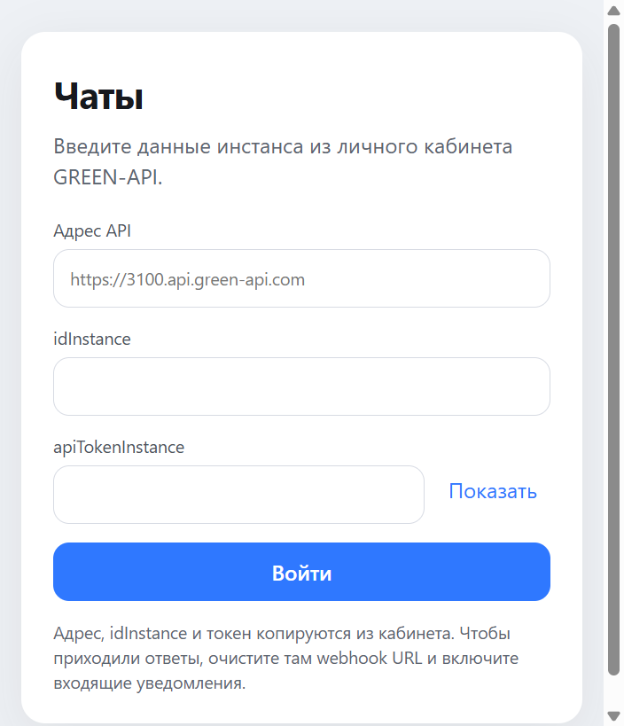
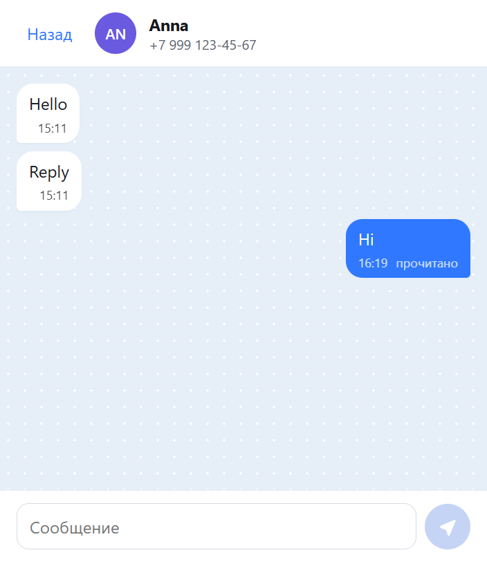
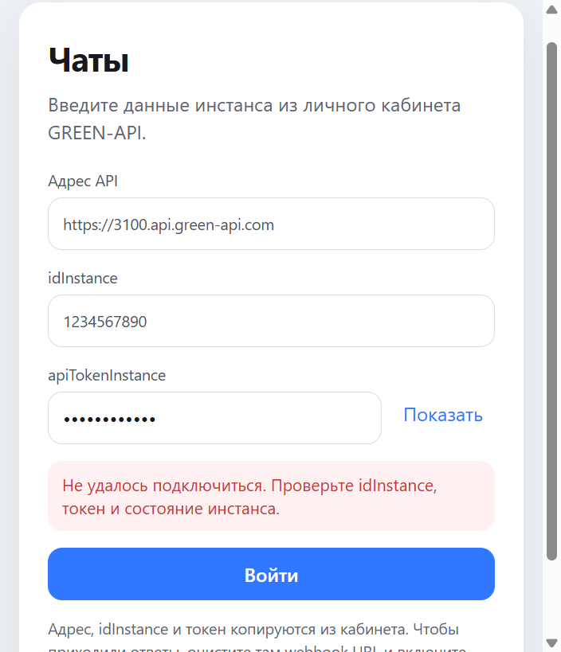

# MAX Chat

Text chat for the MAX messenger. The app talks to a GREEN-API instance: you enter the instance credentials, open a chat by phone number, send a text message, and see the reply.





## Features

- React + TypeScript interface
- GREEN-API integration
- connection via instance credentials
- chat creation by phone number
- sending text messages
- receiving messages
- message statuses
- error handling
- responsive interface

## Tech Stack

- React
- TypeScript
- Vite
- CSS
- GREEN-API HTTP API

## Architecture

- `src/components` — sign-in screen, chat list, conversation
- `src/hooks` — one receive loop: get a notification, handle it, then delete it
- `src/services` — GREEN-API requests and notification parsing
- `src/utils` — phone numbers and chat storage
- `src/styles` — layout

Credentials stay in memory. The chat list is stored in `sessionStorage` until logout or until the tab is closed. The token is not written there.

## GREEN-API

The app uses the instance HTTP API, not the Bot API.

- `CheckAccount` — phone number to `chatId`
- `SendMessage` — send text
- `ReceiveNotification` — next item in the queue
- `DeleteNotification` — remove an item after it was handled

`getStateInstance` checks that the instance is authorized. `getSettings` checks that incoming notifications are on and the webhook URL is empty.

Docs: https://green-api.com/v3/docs/api/

## Run locally

Node.js 20.19 or newer, or 22.12 or newer. `npm test` needs Node.js 22.12 or newer.

```bash
npm install
npm run dev
```

```bash
npm test
npm run lint
npm run build
npm run preview
```

## Configuration

Nothing is hardcoded. On the first screen enter the values from the GREEN-API console:

- API URL
- idInstance
- apiTokenInstance

For replies, turn on incoming notifications in the console and leave the webhook URL empty. Phone numbers are Russian (`7`, 11 digits) or Belarusian (`375`, 12 digits).

## Limitations

- Text messages are supported, including a text reply with a quote. Media and group messages are out of scope.
- If the queue contains a message this chat cannot show, receiving stops and that notification is not deleted.
- Live delivery needs a valid authorized GREEN-API instance. It was not verified against a live MAX account in this repository.
- Notification parsing is covered by tests with sample API payloads. Those tests do not call GREEN-API.

## Author

Timur Navruzov

Portfolio:
https://logogames.org/
